

<h1 align="center">kumahon</h1>

**Raw manga from raw-manga websites and nyaa.si, in one tap.**

---

kumahon (熊 bear + 本 book) is a fork of [Chimahon](https://github.com/sohilsayed/chimahon) that lets you download manga from raw-manga websites and [nyaa.si](https://nyaa.si) with one tap.

It needs an [AniList](https://anilist.co) account. A [Real-Debrid](https://real-debrid.com) Premium account is optional: with one a volume is fetched in one tap, without one it comes by hand or as a torrent.

**Not supported:** light novels (at least for now) and mokuro files.

How it works:

- Your AniList manga list is the library. Home, Library and Discover come from it.
- Open a title, tap a volume, and it is fetched through Real-Debrid from the source that has it. Without a Real-Debrid account the same tap offers a download by hand or a torrent.
- Volumes land in plain series folders on the tablet.

The new screens are made for tablets, and phones get their own narrow version (Settings › Appearance › *New look on phones* switches it off). The classic Chimahon screens stay one tap away (Settings › About › Classic view).

## 🏠 Home and Library

  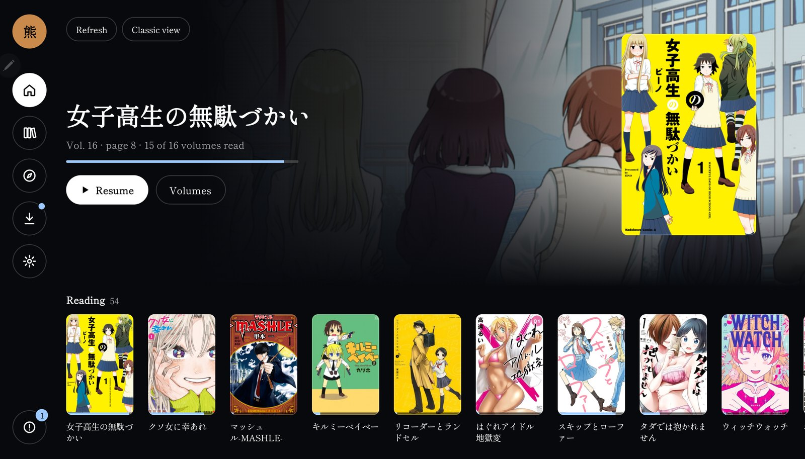
  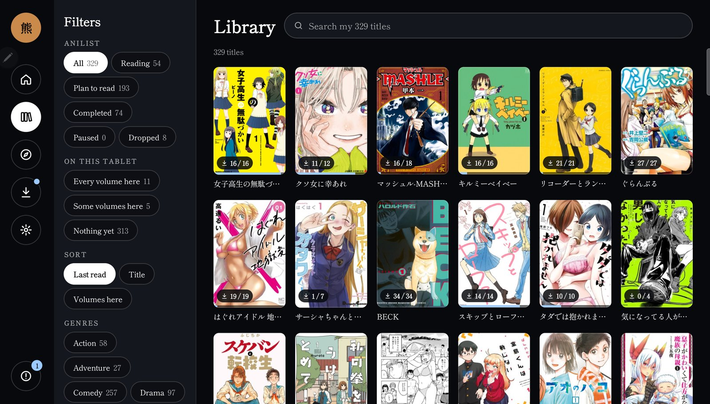

- **Home** is your AniList *Reading* and *Plan to read* lists, with "Continue reading" on top.
- **Library** is the whole list. Filter by list, genre, tag or length, or by what is on the tablet. Each cover shows how many volumes you have.
- Progress goes back to AniList by volume as you finish them.
- A **Covers | History** switch on Home shows what you read last, with Resume on each row. Series you are caught up on go to the end of *Reading*.

## 🧭 Discover

  
  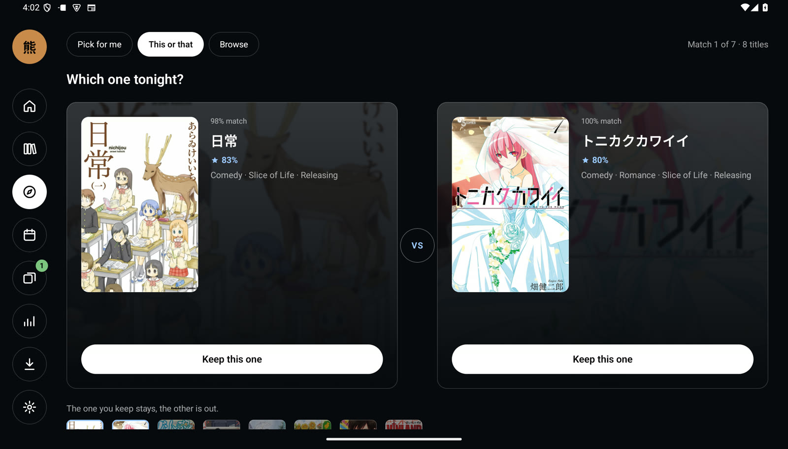
  

Three ways to find what to read next, based on what you finished:

- **Pick for me**: one title, with the reasons it was picked.
- **This or that**: two titles, keep one, until one is left.
- **Browse**: AniList with a filter sidebar (genres, tags, status, length).

## 📚 Title page and sources

  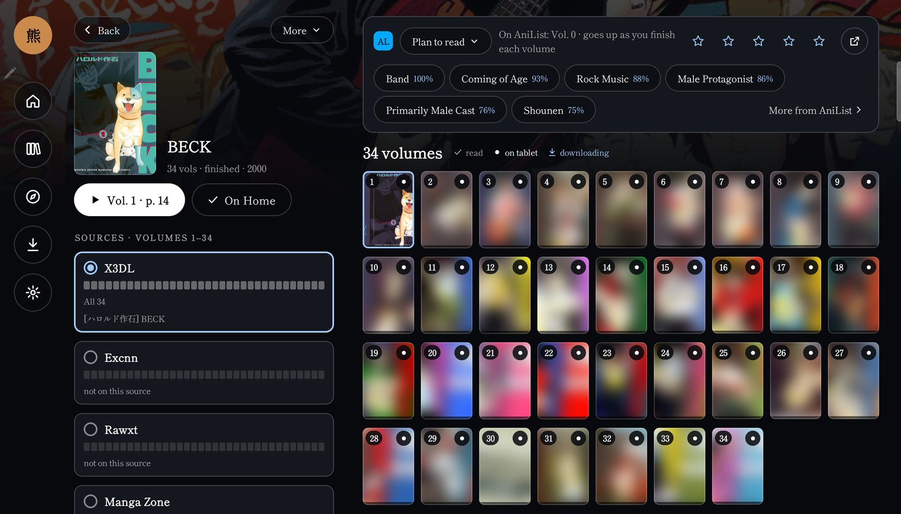
  

- Every volume cover carries one **state badge** (on the device, read, not found and so on), with one legend. Settings has a *Colour set* choice: Default, Green-red or Ice-amber.
- Every **source** shows which volumes it holds, as a box per volume range; a gap is named (a narrow one shows its range, a wide one "20-24 missing"). Sources so far: X3DL, Excnn, Rawxt, Manga Zone, BsZip, A-Z Manga and Nyaa through Real-Debrid, and Manga Zip for downloads by hand.
- Tap a volume and the app says **what will be added** before anything is fetched. A bigger pack or a torrent is never started without asking.
- When a link is dead, the next source is tried, and the source's bar is corrected.
- A volume no source could deliver is marked **Not found**, with the reason above the grid.
- Covers of volumes you have not read can be blurred.
- **Volumes read on AniList** can be set right on the title page: tap *On AniList: Vol. N*, then use the slider or − / +. It saves when you let go, and it can go down to fix a mistake.
- **Select** on the title page deletes the files of volumes you have already read (up to your AniList count), to free space.

## 📅 Releases

  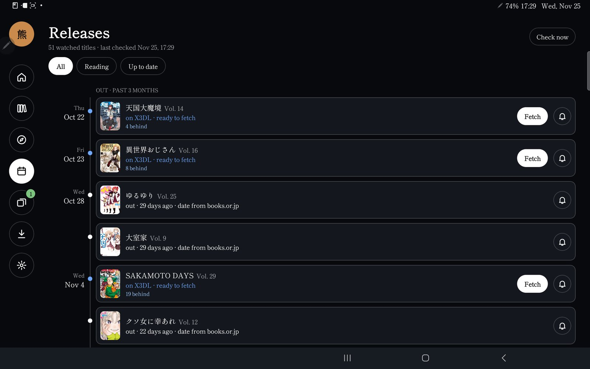
  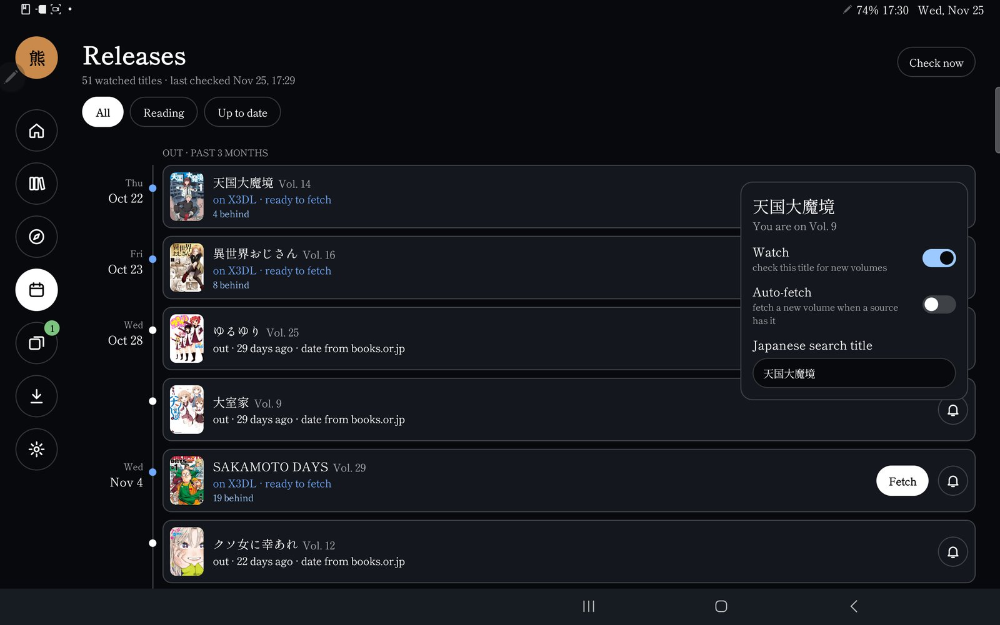

- **Releases** on the rail is a timeline of the newest volume of every manga on your AniList *Reading* list: out in the last 90 days, or announced. If you are behind, the row says how many volumes.
- Dates come from the Japanese publishers' catalogue ([books.or.jp](https://www.books.or.jp)), the National Diet Library and Kodansha's calendar; the sources' coverage says when a volume can be fetched. It checks every day around 09:00 on Wi-Fi, or when you tap *Check now*.
- **Notifications**: *out today*, *on &lt;source&gt;* with a Fetch button, and date changes (quietly).
- **Auto-fetch** (per title, on by default when you are up to date): the next volume is fetched by itself on Wi-Fi, with more than 5 GB free, at most 3 a day. After 3 failed tries it goes to *Needs attention*.

## 📖 Reader, statistics and backup

  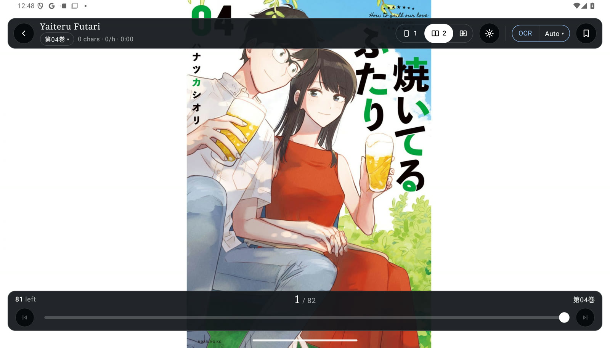
  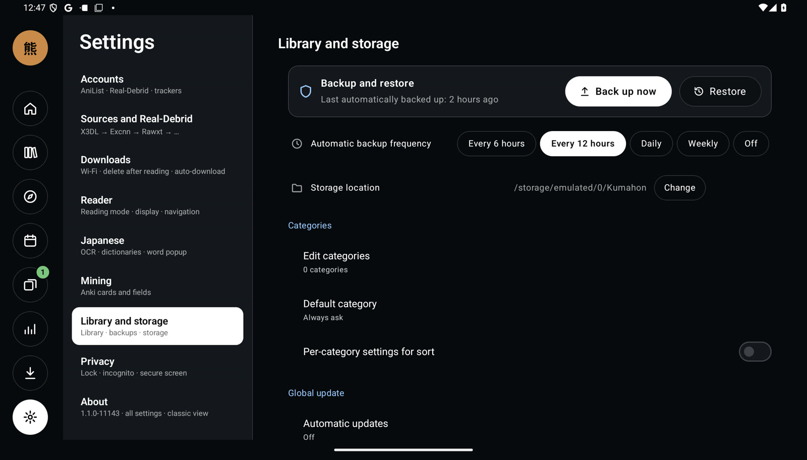

  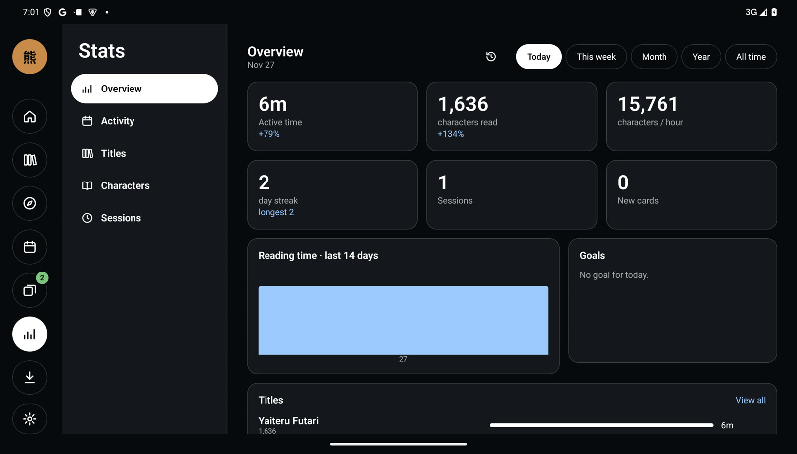

- **Reader**: a top bar (volume, single / double pages, OCR, page bookmark) and a slim page bar that says where you are. Settings, statistics, volumes and the long-press menu open in a side panel.
- **Stats** on the tablet rail: reading time, characters read, speed, streak and cards mined, by day, week, month, year or all time.
- **Backup** in Settings › Library and storage: back up now, restore, how often and where.

## 📱 Phones, torrents and downloads by hand

  
  
  
  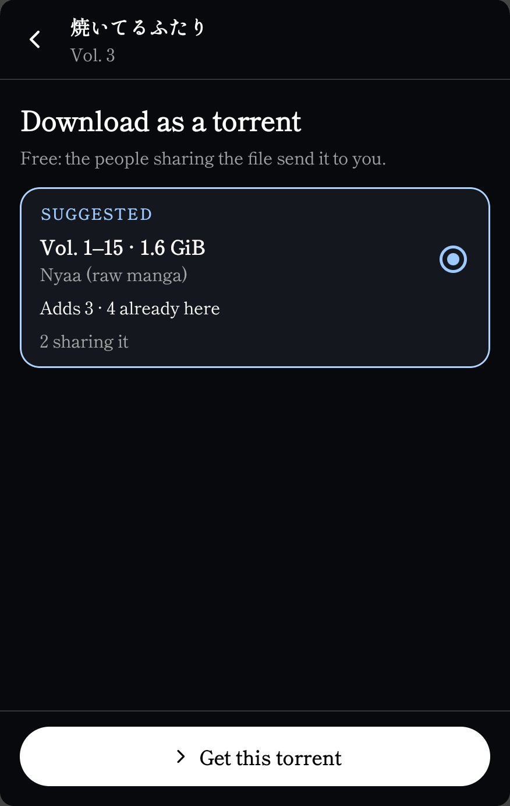

- **Phones**: Home, Discover, Library, title pages and Settings are made for phones; Downloads is the tablet one made narrow. Settings › Appearance switches it off.
- **Download by hand**, without Real-Debrid: the app lists which file of which source holds the volume, opens the hoster's page in your browser, and imports the file you downloaded. A hoster that is quick without an account is suggested first, and dead links are checked before you wait for nothing.
- **Torrents on the device**, without Real-Debrid: a Nyaa torrent is downloaded by the app's own engine. Before it starts, the app opens the torrent and shows what it will download and how big it is, and only the files of the volumes you asked for are fetched. The people sharing a torrent can see your IP address while it runs; the app says so first.
- A file that holds **chapters instead of volumes** is refused and nothing is added. Files whose name suggests that are flagged and offered last.

## ⬇️ Downloads and problems

  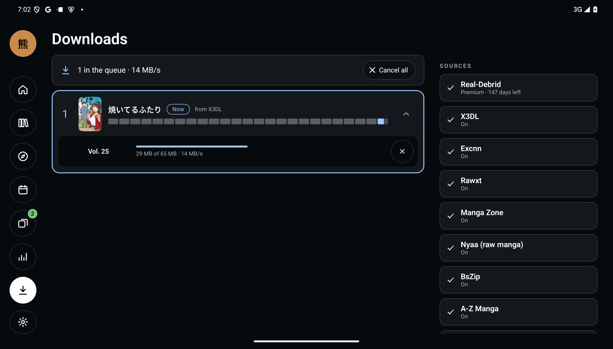
  

- **Downloads**: one row per title with its volume bar, what each job delivered, and the space used on the tablet.
- **Needs attention**: a button appears on the rail when something needs you (a rejected Real-Debrid key, volumes that were not found, AniList unreachable). Each card carries its fix. Reading is never interrupted.

## 🚀 Setup and dictionaries

  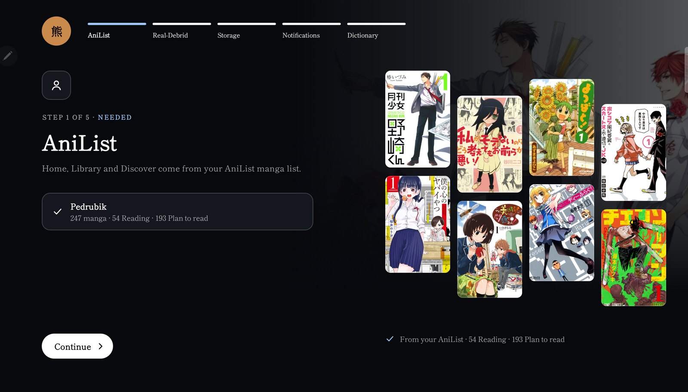
  

- **First-run setup**, one step per screen: AniList, a Real-Debrid key (optional, checked on the spot), the storage folder, notifications, a dictionary, then *Word colouring* and *Known words* as two separate steps. Phones get the same steps in one column.
- **Usual dictionaries** in one tap: Jitendex, JMnedict and KANJIDIC, kept up to date, next to any Yomitan dictionary you import yourself.

## 🃏 Review

- Tap **+** on a word you look up and it becomes a flashcard inside the app, with the sentence it came from. Anki is not needed (if Anki is set up, the card goes there too).
- **Review** on the rail shows how many cards are due. Cards are scheduled with FSRS-6; Undo takes back the last answer.
- The **lookup popup** has a thumb bar at the bottom: pitch accent, the rating buttons (Again, Hard, Good, Easy), *Mark known* and *Mine*.
- **Audio** on the Review screen: tap the word or the sentence, or use the big *Word* and *Sentence* buttons. *Sound* is auto, tap or off. Sentences (and words without a recording) are read by the phone's Japanese voice (Android text-to-speech). Word recordings come from your Yomitan *Local Audio* android.db and a built-in JapanesePod101 source; the app tells you when it lost access to android.db. None of this needs kumapie.

## 🎨 Word colours and faces

- **Word colours** on the page (Settings › Mining › *Colour words*): red new, green due, blue mined, known words plain. kumahon splits the text itself (a one-time 80 MB dictionary download, Wi-Fi only).
- **Known words** come in layers: the most frequent words (1k to 50k, from Jiten's frequency list), words you mark known, and, if you use [kumapie](https://github.com/Pedrubik2000/kumapie-tv), the words and cards it knows; optionally the words of your Anki Mined deck in kuma3 or AnkiDroid on the same device (known when a card is stable for 1 to 30 days, your choice). The page menu counts the new, due and mined words on the pages you see.
- **Sync with kumapie** (optional): pair with kumapie on the same network and only your reviews (rating events) and which words have a card go both ways. Mined cards (text, audio, images) stay in the app that made them. It syncs after each rating or mining, every 15 minutes and on start.
- **Character faces**: a character's picture before their name, from a character dictionary kumahon builds from AniList for the works you read (no spoilers).

## 📥 Download

Builds are on the [Releases](https://github.com/Pedrubik2000/kumahon/releases) page: arm64 for tablets and phones, armeabi-v7a for older devices and TVs. The app installs as "kumahon", next to the original Chimahon.

You need an Android tablet or phone (Android 8.0 or higher) and an AniList account. A Real-Debrid Premium account is optional.

## 📖 What it keeps from Chimahon

The manga side of the original is still here: tap a word on a page to look it up (OCR), Yomitan dictionaries with pitch accent, and Anki card mining. The two-finger tap that toggles OCR is off by default (reader settings turn it on). See the [original README](https://github.com/sohilsayed/chimahon#readme) for those.

The original's novel reader, mokuro support and anime player are still in the code, but this fork does not work on them or test them. Light novels on your AniList list are hidden in the new screens. For novels or mokuro, use the original Chimahon.

## 🤝 Credits

- [Chimahon](https://github.com/sohilsayed/chimahon) by sohilsayed, and [Mihon](https://github.com/mihonapp/mihon) and [Komikku](https://github.com/komikku-app/komikku) under it. Questions about anything outside the tablet look belong there.
- [Yomitan](https://github.com/yomidevs/yomitan): inspiration for language-processing workflows.
- [owocr](https://github.com/AuroraWright/owocr): base for OCR merge and reconstruction logic.
- [hoshidicts](https://github.com/Manhhao/hoshidicts/): native dictionary engine.
- Word colouring: [Sudachi](https://github.com/WorksApplications/Sudachi) and SudachiDict (Apache-2.0) split Japanese into words, with a port of
  [Jiten](https://github.com/Sirush/Jiten)'s parser (Apache-2.0) and [JL](https://github.com/rampaa/JL)'s deconjugation rules (Apache-2.0), the same as kumapie.
- Character faces: a Kotlin port of [Japanese Character Name Dictionary](https://github.com/bee-san/Japanese_Character_Name_Dictionary)
  by Autumn (Bee) (MIT, see `kumahon-core/.../chardict/NOTICE.md`), with character data from [AniList](https://anilist.co).
- [Jitendex](https://jitendex.org) and the [EDRDG](https://www.edrdg.org/) (JMnedict, KANJIDIC): the dictionaries offered for download.
- [Machita Chima (町田ちま)](https://www.youtube.com/channel/UCo7TRj3cS-f_1D9ZDmuTsjw): app name inspiration.

### License

This project is licensed under the **GNU General Public License v3.0**. See [LICENSE](./LICENSE) for details.
