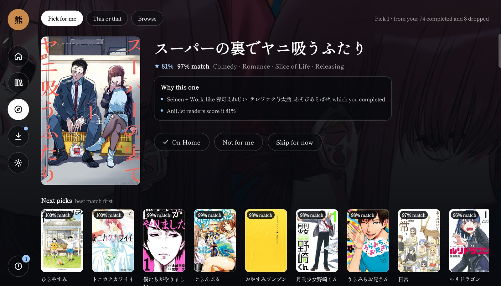
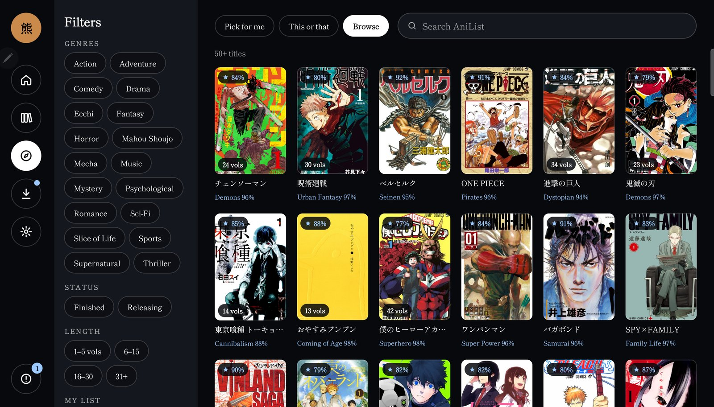
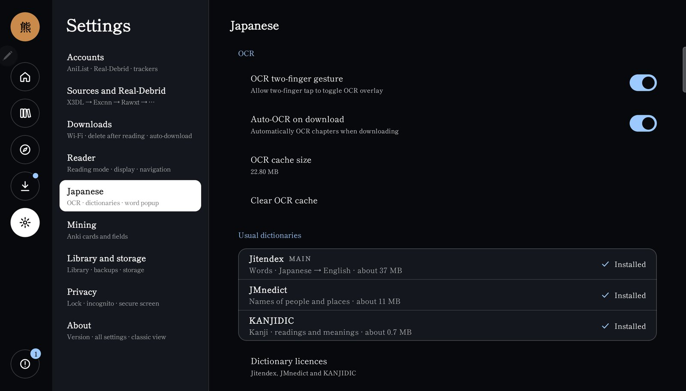

<h1 align="center">Chimahon</h1>

**Mihon-focused immersion fork with Manga, Novel, and Anime support.**

---

Chimahon is a specialized Android reader designed for language learners and immersion enthusiasts. It extends the powerful core of **Mihon/Komikku** with integrated tools for dictionary lookup, OCR-assisted text capture, and seamless flashcard creation for vocabulary mining.

## 🖼️ Screenshots

  
  
  
  

## 📱 This fork: a tablet look built on your AniList list

This fork ([Pedrubik2000/chimahon](https://github.com/Pedrubik2000/chimahon)) adds a second shell for tablets. A title is an AniList entry, its volumes are fetched through Real-Debrid from raw-manga sources, and everything on the tablet lives in plain series folders. The classic Chimahon screens stay one tap away (Settings › About › Classic view), and phones keep the classic look.

  
  

- **Home** is your AniList *Reading* and *Plan to read* lists, with "Continue reading" on top.
- **Library** is the whole list: filter by list, genre, tag, length, or by what is on the tablet.

  
  
  

- **Discover** suggests what to read next from what you finished: one pick with its reasons, a "this or that" knockout, or a filtered browse of AniList.

  
  

- **Title page**: every source shows which volumes it holds. Tap a volume and the app says what will be added before anything is fetched. Covers of unread volumes can be blurred. A volume no source could deliver is marked *Not found*.
- **Sources** (through Real-Debrid): X3DL, Excnn, Rawxt, Manga Zone, BsZip, A-Z Manga and Nyaa. A bigger pack or a torrent is never started without asking.

  
  

- **Downloads**: one row per title with its volume bar, what each job delivered, and the space used on the tablet.
- **Needs attention**: a button on the rail appears when something needs you (a rejected Real-Debrid key, volumes that were not found, AniList unreachable), with the fix on each card.

  
  

- **First-run setup**, one step per screen: AniList, a Real-Debrid key (checked on the spot), the storage folder, notifications and a dictionary.
- **Usual dictionaries** in one tap: Jitendex, JMnedict and KANJIDIC, kept up to date, next to any Yomitan dictionary you import yourself.

Tablet builds are on the fork's [Releases](https://github.com/Pedrubik2000/chimahon/releases) page.

## 🚀 Key Immersion Features

### 📖 Novel & Manga Support
- **Novel Reader**: E-book reader with inline dictionary lookup and an illustration viewer for art OCR and vocabulary mining.
- **Manga Reader**: Native reading experience with support for all major online and local sources.
- **Local OCR**: High-performance, on-device text recognition — no internet connection required.
- **.mokuro Support**: Native integration for reading `.mokuro` formatted manga files with pre-rendered OCR overlays.

### 🔍 Native Dictionary Lookup
- **Dictionary Tab**: Import and manage multiple dictionary files directly in-app.
- **Multi-Language Support**: Full support for Japanese, Chinese, Korean, and more.
- **Recursive Lookups**: Effortlessly search within definitions to clarify complex terms.
- **Slick Dictionary Popup**: A modern, customizable lookup interface with support for custom fonts, themes, and recursive searches.
- **E-Ink Optimized**: High-contrast mode designed specifically for e-paper devices.
- **Pitch Accent**: Native support for visualizing Japanese pitch accent patterns.

### 🎴 Anki Integration
- **Direct Mining**: Create Anki cards instantly from lookup results while reading.
- **Screenshot Crop**: Manually crop images for your cards with specialized UI.
- **Smart Markers**: Flexible field mapping for expression, reading, glossary, pitch, and context sentences.
- **Duplicate Checking**: Reliable duplicate detection to prevent redundant flashcards.

### 🌐 Screen OCR Lookup
- **Any App**: Look up and mine text from any app — capture your screen, tap any word, and get an instant dictionary definition.

### 🎬 Anime & Video Player
- **Video Player**: Full MPV player with subtitle lookup and frame-accurate OCR for vocabulary mining.
- **Jimaku Support**: Seamless integration for searching, fetching, and syncing Japanese subtitles.
- **Video Frame OCR**: Look up any on-screen text, signs, or hardsubs directly from the video, even if it's not present in the subtitle file.
- **Built-in YouTube Extension**: Stream and mine content directly from YouTube inside the app.
- **Anime Library**: Browse, track, and organize your anime with source extensions and external tracker sync.

---

## 🛠️ Core Features (Inherited from Upstream)

Chimahon retains all the features of **Komikku** and **Mihon**:

  

- **Massive Source Support**: Access thousands of manga via community-made extensions.
- **Suggestions**: Discover related titles directly within the app.
- **Auto-Theme**: UI colors that adapt to the cover art of what you're reading.
- **Cloud Sync**: 2-way progress tracking with MyAnimeList, AniList, Kitsu, and more.
- **Privacy & Backups**: Hidden categories and secure backups (Local or Cloud).
- **Customization**: Extensive theme options, color palettes, and reader settings.

---

## 📥 Download

*Requires Android 8.0 or higher.*

---

## 🤝 Contributing & Support

- **Bugs/Requests**: Please check the [Changelog](./CHANGELOG.md) and open an [Issue](https://github.com/sohilsayed/chimahon/issues).
- **Discord**: Join our community for help and discussion: [Join Discord](https://discord.gg/Ak2sW9Nvr9)
- **Contributing**: Pull requests are welcome! See [CONTRIBUTING.md](./CONTRIBUTING.md) for details.

### Credits & Acknowledgments

- [Yomitan](https://github.com/yomidevs/yomitan): Inspiration for language-processing workflows.
- [owocr](https://github.com/AuroraWright/owocr): Base for OCR merge and reconstruction logic.
- [hoshidicts](https://github.com/Manhhao/hoshidicts/): Native dictionary engine powering our lookups.
- [Machita Chima (町田ちま)](https://www.youtube.com/channel/UCo7TRj3cS-f_1D9ZDmuTsjw): App name inspiration.

### License

This project is licensed under the **GNU General Public License v3.0**. See [LICENSE](./LICENSE) for details.

---

  
Made with ❤️ for the immersion community.

  

