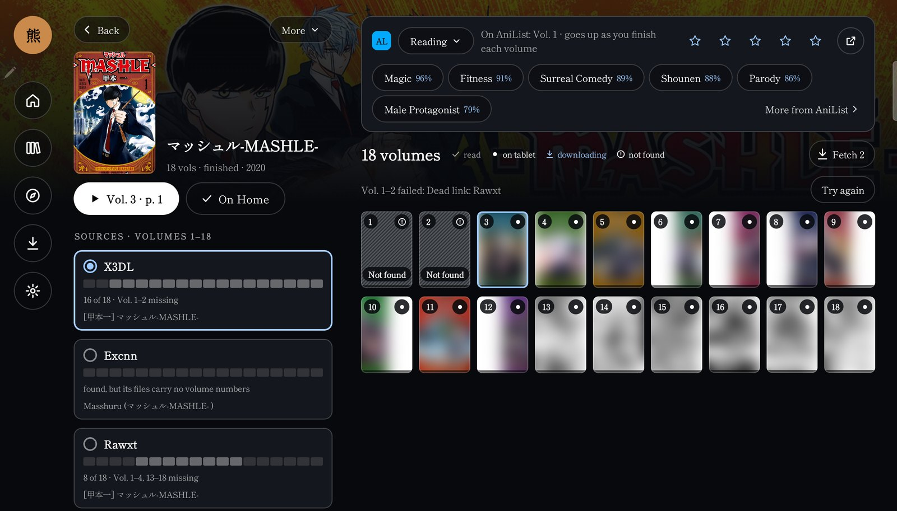
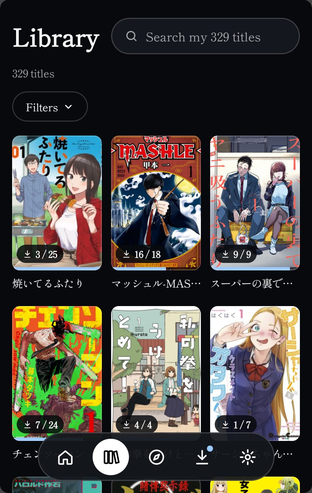
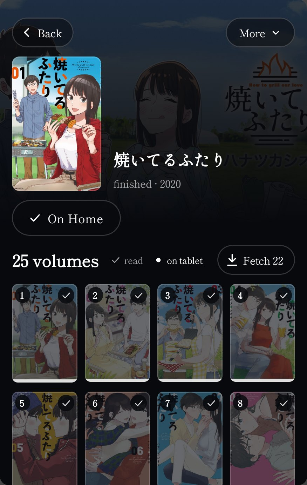
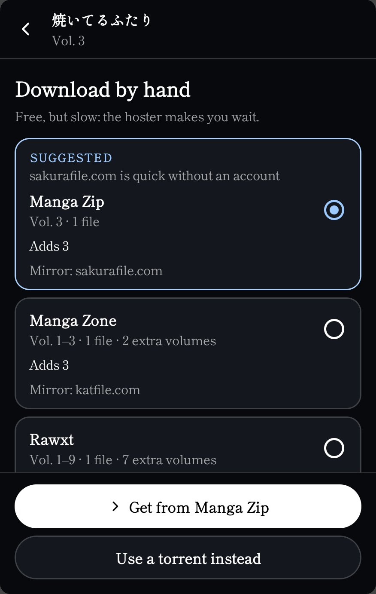
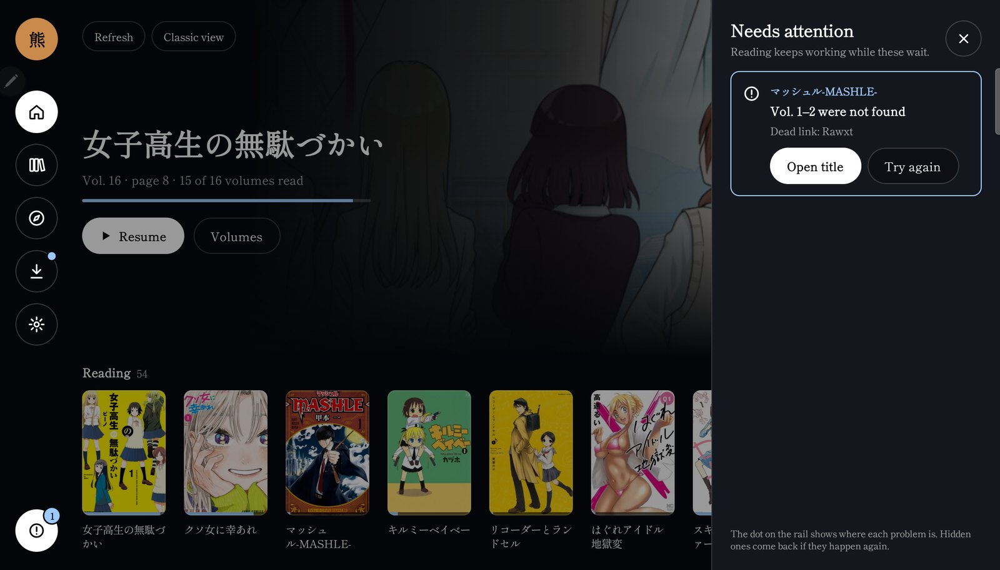

<h1 align="center">kumahon</h1>

**Raw manga from raw-manga websites and nyaa.si, in one tap.**

---

kumahon (熊 bear + 本 book) is a fork of [Chimahon](https://github.com/sohilsayed/chimahon) that lets you download manga from raw-manga websites and [nyaa.si](https://nyaa.si) with one tap.

It needs an [AniList](https://anilist.co) account and a [Real-Debrid](https://real-debrid.com) Premium account.

**Not supported:** light novels (at least for now) and mokuro files.

How it works:

- Your AniList manga list is the library. Home, Library and Discover come from it.
- Open a title, tap a volume, and it is fetched through Real-Debrid from the source that has it.
- Volumes land in plain series folders on the tablet.

The new screens are made for tablets. Phones can switch them on in Settings › Appearance › *New look on phones* (still in progress); otherwise they keep the classic look. The classic Chimahon screens stay one tap away (Settings › About › Classic view).

## 🏠 Home and Library

  
  

- **Home** is your AniList *Reading* and *Plan to read* lists, with "Continue reading" on top.
- **Library** is the whole list. Filter by list, genre, tag or length, or by what is on the tablet. Each cover shows how many volumes you have.
- Progress goes back to AniList by volume as you finish them.

## 🧭 Discover

  
  
  

Three ways to find what to read next, based on what you finished:

- **Pick for me**: one title, with the reasons it was picked.
- **This or that**: two titles, keep one, until one is left.
- **Browse**: AniList with a filter sidebar (genres, tags, status, length).

## 📚 Title page and sources

  
  

- Every **source** shows which volumes it holds, as a bar. Sources so far: X3DL, Excnn, Rawxt, Manga Zone, BsZip, A-Z Manga and Nyaa through Real-Debrid, and Manga Zip for downloads by hand.
- Tap a volume and the app says **what will be added** before anything is fetched. A bigger pack or a torrent is never started without asking.
- When a link is dead, the next source is tried, and the source's bar is corrected.
- A volume no source could deliver is marked **Not found**, with the reason above the grid.
- Covers of volumes you have not read can be blurred.

## 📱 Phones, torrents and downloads by hand

  
  
  
  

- **Phones** (optional, still in progress): Home and Discover are made for phones; Library, Downloads and title pages are the tablet ones made narrow. Turn it on in Settings › Appearance.
- **Download by hand**, without Real-Debrid: the app lists which file of which source holds the volume, opens the hoster's page in your browser, and imports the file you downloaded. A hoster that is quick without an account is suggested first, and dead links are checked before you wait for nothing.
- **Torrents on the device**, without Real-Debrid: a Nyaa torrent is downloaded by the app's own engine. Before it starts, the app opens the torrent and shows what it will download and how big it is, and only the files of the volumes you asked for are fetched. The people sharing a torrent can see your IP address while it runs; the app says so first.
- A file that holds **chapters instead of volumes** is refused and nothing is added. Files whose name suggests that are flagged and offered last.

## ⬇️ Downloads and problems

  
  

- **Downloads**: one row per title with its volume bar, what each job delivered, and the space used on the tablet.
- **Needs attention**: a button appears on the rail when something needs you (a rejected Real-Debrid key, volumes that were not found, AniList unreachable). Each card carries its fix. Reading is never interrupted.

## 🚀 Setup and dictionaries

  
  

- **First-run setup**, one step per screen: AniList, a Real-Debrid key (checked on the spot), the storage folder, notifications and a dictionary.
- **Usual dictionaries** in one tap: Jitendex, JMnedict and KANJIDIC, kept up to date, next to any Yomitan dictionary you import yourself.

## 📥 Download

Builds are on the [Releases](https://github.com/Pedrubik2000/kumahon/releases) page: arm64 for tablets and phones, armeabi-v7a for older devices and TVs. The app installs as "kumahon", next to the original Chimahon.

You need an Android tablet (Android 8.0 or higher), an AniList account and a Real-Debrid Premium account.

## 📖 What it keeps from Chimahon

The manga side of the original is still here: tap a word on a page to look it up (OCR), Yomitan dictionaries with pitch accent, and Anki card mining. See the [original README](https://github.com/sohilsayed/chimahon#readme) for those.

The original's novel reader, mokuro support and anime player are still in the code, but this fork does not work on them or test them. Light novels on your AniList list are hidden in the new screens. For novels or mokuro, use the original Chimahon.

## 🤝 Credits

- [Chimahon](https://github.com/sohilsayed/chimahon) by sohilsayed, and [Mihon](https://github.com/mihonapp/mihon) and [Komikku](https://github.com/komikku-app/komikku) under it. Questions about anything outside the tablet look belong there.
- [Yomitan](https://github.com/yomidevs/yomitan): inspiration for language-processing workflows.
- [owocr](https://github.com/AuroraWright/owocr): base for OCR merge and reconstruction logic.
- [hoshidicts](https://github.com/Manhhao/hoshidicts/): native dictionary engine.
- [Jitendex](https://jitendex.org) and the [EDRDG](https://www.edrdg.org/) (JMnedict, KANJIDIC): the dictionaries offered for download.
- [Machita Chima (町田ちま)](https://www.youtube.com/channel/UCo7TRj3cS-f_1D9ZDmuTsjw): app name inspiration.

### License

This project is licensed under the **GNU General Public License v3.0**. See [LICENSE](./LICENSE) for details.
